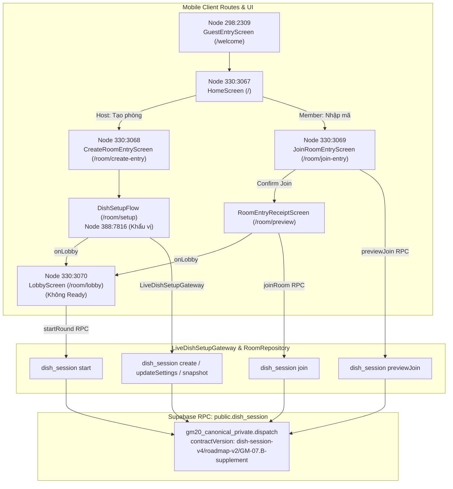

# Báo cáo đối chiếu Figma — GM-25 / roadmap-v2: UI–API guest, Home, phòng, khẩu vị và lobby

- **Task**: GM-25 (Issue #86)
- **Assignee**: @rosy179 (Trang)
- **Reviewer**: @ThanhTris (Trí)
- **Figma file**: `3Ysh0mOAEkAgA5DgZPSC1j` (Gì Cũng Được App)
- **Mã revision UI**: `ui-figma-final/2026-10-25/GM-25.2`
- **Màn hình thực tế trên main**:
  - `mobile/src/features/home/screens/GuestEntryScreen.tsx` (Route `/welcome`)
  - `mobile/src/features/home/screens/HomeScreen.tsx` (Route `/`)
  - `mobile/src/features/rooms/screens/CreateRoomEntryScreen.tsx` (Route `/room/create-entry`) & `mobile/src/app/room/create.tsx`
  - `mobile/src/features/rooms/screens/JoinRoomEntryScreen.tsx` (Route `/room/join-entry`) & `mobile/src/app/room/join.tsx`
  - `mobile/src/features/context/screens/DishSetupFlow.tsx` & `DishPreferencesScreen.tsx` (Route `/room/setup`)
  - `mobile/src/features/rooms/screens/LobbyScreen.tsx` (Route `/room/lobby`)
- **Tầng dịch vụ & Gateway**:
  - `mobile/src/features/rooms/services/roomRepository.ts` (`LiveRoomRepository`)
  - `mobile/src/bootstrap/liveDishSetupGateway.ts` (`createLiveDishSetupGateway`)
  - `mobile/src/bootstrap/RoomRepositoryProvider.tsx`

---

## 1. Ma trận đối chiếu 6 Figma Nodes

| Figma Node | Tên Frame / Trạng thái | Yêu cầu thiết kế Figma | Hiện thực thực tế trong source & routes | Trạng thái đối chiếu |
| --- | --- | --- | --- | --- |
| `298:2309` | **Mở app · Chọn cách tham gia** | - Mở app lần đầu (chưa có session): Điều hướng vào màn chào mừng / nhập tên khách. - Cho phép chọn 2 phương thức tham gia: "Tạo kèo ăn" (Host) hoặc "Tôi có mã phòng" (Member). - Tạo phiên khách (guest session) trước khi điều hướng sang route tiếp theo. | Hiện thực trong `GuestEntryScreen.tsx` (trên `/welcome`) và sheet onboarding trong `HomeScreen.tsx` (trên `/`). Tạo duy nhất 1 guest session sau khi người dùng xác nhận tên hợp lệ (1–24 ký tự), sau đó mới điều hướng vào luồng tạo hoặc nhập mã phòng. | **Pass (Code & Component Test) / Not run (Android Visual)** |
| `330:3067` | **02 · Khách / Trang chủ / Tiếp tục phiên** | - Hiển thị danh tính khách đã lưu ("Chào mừng, [Tên khách]!"). - Nếu có phòng đang tham gia dở dang: Hiển thị thẻ/nút "Vào lại phòng đang dở" kèm mã phòng và trạng thái. - Cung cấp 2 nút hành động nhanh: "Tạo phòng mới" và "Nhập mã vào phòng". - Có tùy chọn đổi/xóa phiên khách cục bộ. | Hiện thực trong `HomeScreen.tsx` (trên `/`). Hiển thị lời chào kèm tên khách restored từ SecureStore. Render card phiên dở dang dẫn vào `/continue-session`. Hai nút chính mở `/room/create` và `/room/join`. Có tùy chọn xóa phiên / recovery. | **Pass (Code & Component Test) / Not run (Android Visual)** |
| `330:3068` | **03 · Tạo phòng / Hẹn giờ / Tình huống** | - Form thiết lập dish-only (ADR-019, 10–20 món, không GPS anchor). - Lựa chọn buổi ăn: Sáng / Trưa / Tối / Ăn vặt. - Lựa chọn thời gian: "Ăn ngay" (desiredAt: null) hoặc preset hẹn giờ (+15p, +1h). - Stepper chọn số món (chặn dưới 10, chặn trên 20 món). - Kết nối API canonical v4 tạo phòng & cập nhật bối cảnh, giữ nguyên dishCount được chọn. | Hiện thực qua `CreateRoomEntryScreen.tsx`, `setup.tsx` và `liveDishSetupGateway.ts`. Khi ở chế độ real, route `/room/setup` tải `DishSetupFlow` được cấp `LiveDishSetupGateway`, kết nối trực tiếp với command `create`/`updateSettings` trên `dish_session` với contract `dish-session-v4/roadmap-v2/GM-07.B-supplement`. Gửi đúng `settings: { dishCount, mealSlot, desiredAt }`. | **Pass (Code & Component Test) / Not run (Android Visual)** |
| `330:3069` | **05 · Tham gia phòng / QR / Lỗi vào phòng** | - Ô nhập mã phòng 6 ký tự chuẩn hoá. - Nút quét mã QR chuyển đổi chế độ nhập. - **Xem trước phòng trước khi vào (Public Room Preview)**: Hiển thị mã phòng và số lượng thành viên hiện tại (`memberCount/memberLimit`). - **Bảo vệ quyền riêng tư**: Tuyệt đối không để lộ danh sách thành viên cụ thể, khẩu vị cá nhân hay phiếu bầu trước khi bấm xác nhận vào phòng. - Banner hiển thị lỗi khi mã phòng không tồn tại hoặc lỗi kết nối. | Hiện thực qua `JoinRoomEntryScreen.tsx`, `join-entry.tsx`, và method `previewJoin(code)` trong `roomRepository.ts`. Phương thức `previewJoin` gọi `dish_session` (command `previewJoin`) với contract `GM-07.B-supplement`, dùng schema guard `isPreviewJoinAck`. Trả về `MALFORMED_RESPONSE` nếu data sai lệch (không dùng fallback số người giả). Trả lỗi `ROOM_FULL`, `ROOM_LOCKED`, `ROOM_EXPIRED` khi có reasonCode. Sau xác nhận, điều hướng sang `/room/preview` (biên nhận phòng). | **Pass (Code & Component Test) / Not run (Android Visual)** |
| `388:7816` | **04 · Khẩu vị / Lưu nháp / Lỗi** | - Lựa chọn khẩu vị cá nhân (cay, ngọt, kiêng kỵ, v.v.). - Chức năng lưu bản nháp thiết lập ("Lưu bản nháp"). - Xử lý sự cố mạng / timeout máy chủ với thông báo lỗi và nút "Thử lại". - Bảng kiểm tra quyền riêng tư (Privacy Audit Panel) tuân thủ AIDD: 0 GPS thô, độc lập quán ăn/vị trí. | Hiện thực trong `DishPreferencesScreen.tsx` nằm trong `DishSetupFlow.tsx`. Nút lưu draft, banner phản hồi, và thông báo lỗi với action retry. Khi mất mạng (`NETWORK_ERROR` / `TIMEOUT`), gateway trả mã `UNKNOWN` cho phép thử lại với nguyên vẹn request payload/intent mà không tạo intent mới. Khi thiếu món trong catalogue, hiển thị dialog `SHORTAGE` với số món sẵn có/yêu cầu. | **Pass (Code & Component Test) / Not run (Android Visual)** |
| `330:3070` | **06 · Phòng chờ / Chủ phòng / Thành viên** | - Giao diện phòng chờ phân quyền Host và Member. - **Loại bỏ hoàn toàn luồng Ready**: Theo consumer v4 / ADR-019, không còn nút "Tôi sẵn sàng" hay trạng thái chờ sẵn sàng. - **Host**: Thấy nút CTA "Bắt đầu chọn món" (kích hoạt khi danh sách >= 1 thành viên và pool món hợp lệ). - **Member**: Thấy trạng thái "Chờ chủ phòng bắt đầu" và nút "Rời phòng". - Giới hạn tối đa 20 thành viên. | Hiện thực trong `LobbyScreen.tsx` trên route `/room/lobby`. Đã gỡ bỏ toàn bộ RPC và cờ ready trong UI hoạt động. Host có quyền bấm bắt đầu phiên trực tiếp; Member có nút rời phòng; UI hiển thị danh sách người tham gia (tối đa 20 người) cùng mã phòng kèm nút sao chép / QR. | **Pass (Code & Component Test) / Not run (Android Visual)** |

---

## 2. Kiến trúc Dispatch và Xử lý Lỗi

### Các nguyên tắc xử lý lỗi và tính bất biến:
1. **Idempotency & Request ID bền vững**:
   - `DishSetupRoute` inject hàm `createDurableRequestId('setup')` sinh id dạng `^[A-Za-z0-9_-]{1,128}$`.
   - Payload `desiredAt` được đóng băng: `null` khi chọn "Ăn ngay" (không re-compute `new Date().toISOString()` mỗi lần retry).
2. **Ánh xạ lỗi rõ ràng (Error Mapping)**:
   - `INSUFFICIENT_DISHES` → `SHORTAGE` (kèm `available` và `requested`)
   - `VERSION_CONFLICT` → `STALE` (buộc reload snapshot)
   - `NETWORK_ERROR` / `TIMEOUT` → `UNKNOWN` (giữ nguyên intent để bấm "Thử lại cùng yêu cầu")
   - `ROOM_EXPIRED` / `ROOM_TERMINAL` → `CLOSED`
3. **Bảo mật xem trước (Public Preview Privacy)**:
   - Schema guard `isPreviewJoinAck` kiểm tra chặt chẽ `joinable`, `memberCount`, `memberLimit: 20`, `dishCount`, `mealSlot`, `roomState`.
   - Trả `MALFORMED_RESPONSE` khi response rỗng hoặc không đúng schema; không dùng số người giả.
4. **Không nuốt lỗi Snapshot**:
   - Khi đọc snapshot phòng thất bại (mất mạng, timeout), `read()` ném lỗi để hook xử lý và cung cấp nút thử đọc lại rõ ràng.

---

## 3. Giới hạn nghiệm thu

- **Thiết bị Android thật**: `Not run`. Chưa kết nối thiết bị qua ADB để so sánh pixel và visual render trên các viewport khác nhau (320dp, 360dp, 412dp) và font scale 200%.
- **Backend Supabase staging từ xa**: `Not run`. Kiểm thử hiện tại được thực thi với synthetic session và API dispatch contract assertions.
- Nghiệm thu thực tế trên thiết bị và cơ sở dữ liệu backend do chủ dự án Trí (`ThanhTris`) trực tiếp thực hiện.
