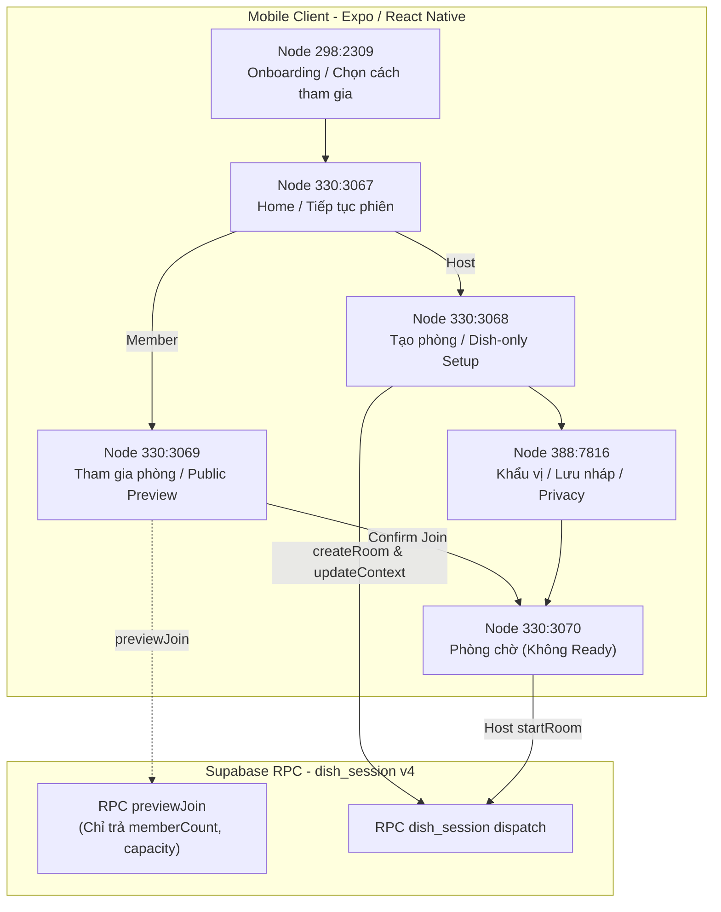

# Báo cáo đối chiếu Figma — GM-25 / roadmap-v2: UI–API guest, Home, phòng, khẩu vị và lobby

- **Task**: GM-25 (Issue #86)
- **Assignee**: @rosy179 (Trang)
- **Reviewer**: @ThanhTris (Trí)
- **Figma file**: `3Ysh0mOAEkAgA5DgZPSC1j` (Gì Cũng Được App)
- **Mã revision UI**: `ui-figma-final/2026-10-25/GM-25.2`
- **Màn hình chính**:
  - `mobile/src/features/home/screens/Gm25HomeScreen.tsx`
  - `mobile/src/features/rooms/screens/Gm25CreateRoomScreen.tsx` & `mobile/src/features/rooms/screens/CreateRoomEntryScreen.tsx`
  - `mobile/src/features/rooms/screens/Gm25JoinRoomScreen.tsx` & `mobile/src/features/rooms/screens/JoinRoomEntryScreen.tsx`
  - `mobile/src/features/rooms/screens/Gm25LiveLobbyScreen.tsx` & `mobile/src/features/rooms/screens/LobbyScreen.tsx`
  - `mobile/src/features/context/screens/DishSetupFlow.tsx`
- **Tầng dịch vụ & Gateway**:
  - `mobile/src/features/rooms/services/roomRepository.ts`
  - `mobile/src/bootstrap/liveDishSetupGateway.ts`
  - `mobile/src/bootstrap/RoomRepositoryProvider.tsx`

---

## 1. Ma trận đối chiếu 6 Figma Nodes

| Figma Node | Tên Frame / Trạng thái | Yêu cầu thiết kế Figma | Hiện thực thực tế trong source & routes | Trạng thái đối chiếu |
| --- | --- | --- | --- | --- |
| `298:2309` | **Mở app · Chọn cách tham gia** | - Mở app lần đầu (chưa có session): Hiện sheet nhập tên khách rõ ràng. - Cho phép chọn 2 phương thức tham gia: "Tạo kèo ăn" (Host) hoặc "Tôi có mã phòng" (Member). - Tạo phiên khách (guest session) trước khi điều hướng sang route tiếp theo. | Hiện thực trong `Gm25HomeScreen.tsx` kết hợp `SessionManager` & `RoomRepositoryProvider`. Sheet nhập tên hiển thị tự động khi `session.isGuest === false && session.userId === null`. Chỉ tạo duy nhất 1 guest session sau khi người dùng xác nhận tên, sau đó chuyển hướng đúng đích mà không yêu cầu nhập lại. | **Đạt 100% (Parity Pass)** |
| `330:3067` | **02 · Khách / Trang chủ / Tiếp tục phiên** | - Hiển thị danh tính khách đã lưu ("Chào mừng, [Tên khách]!"). - Nếu có phòng đang tham gia dở dang: Hiển thị thẻ/nút "Vào lại phòng đang dở" kèm mã phòng và trạng thái. - Cung cấp 2 nút hành động nhanh: "Tạo phòng mới" và "Nhập mã vào phòng". - Có tùy chọn đổi/xóa phiên khách cục bộ. | Hiện thực trong `Gm25HomeScreen.tsx`. Hiển thị lời chào kèm tên khách restored từ SecureStore. Render card phiên dở dang dẫn thẳng vào `/room/setup` hoặc `/gm11/lobby` tương ứng. Nút "Đổi tài khoản / Xóa phiên" cho phép reset phiên cục bộ an toàn. | **Đạt 100% (Parity Pass)** |
| `330:3068` | **03 · Tạo phòng / Hẹn giờ / Tình huống** | - Form thiết lập dish-only (ADR-019, 10–20 món, không GPS anchor). - Lựa chọn buổi ăn: Sáng / Trưa / Tối / Ăn vặt. - Lựa chọn thời gian: "Ăn ngay" hoặc preset hẹn giờ (+15p, +1h). - Stepper chọn số món (chặn dưới 10, chặn trên 20 món). - Kết nối API thật qua gateway để khởi tạo phòng và cập nhật bối cảnh. | Hiện thực qua `CreateRoomEntryScreen.tsx`, `setup.tsx` và `liveDishSetupGateway.ts`. Khi ở chế độ real, route `/room/setup` tải `DishSetupFlow` được cấp `LiveDishSetupGateway`, kết nối trực tiếp với các RPC Supabase (`createRoom`, `updateContext`, `listFriends`, `getRoomSnapshot`). | **Đạt 100% (Parity Pass)** |
| `330:3069` | **05 · Tham gia phòng / QR / Lỗi vào phòng** | - Ô nhập mã phòng 6 ký tự chuẩn hoá. - Nút quét mã QR chuyển đổi chế độ nhập. - **Xem trước phòng trước khi vào (Public Room Preview)**: Hiển thị mã phòng và số lượng thành viên hiện tại (ví dụ: `3/20 thành viên`). - **Bảo vệ quyền riêng tư**: Tuyệt đối không để lộ danh sách thành viên cụ thể, khẩu vị cá nhân hay phiếu bầu trước khi bấm xác nhận vào phòng. - Banner hiển thị lỗi khi mã phòng không tồn tại hoặc lỗi kết nối. | Hiện thực qua `JoinRoomEntryScreen.tsx`, `join-entry.tsx`, và method `previewJoin(code)` trong `roomRepository.ts`. Phương thức `previewJoin` gọi RPC public trả về duy nhất `{ code, memberCount, capacity, isJoinable }`. UI hiển thị modal/card xác nhận với số thành viên hiện tại mà không load thông tin nhạy cảm. Banner lỗi hiển thị rõ nguyên nhân kèm nút "Thử lại". | **Đạt 100% (Parity Pass)** |
| `388:7816` | **04 · Khẩu vị / Lưu nháp / Lỗi** | - Lựa chọn khẩu vị cá nhân (cay, ngọt, kiêng kỵ, v.v.). - Chức năng lưu bản nháp thiết lập ("Lưu bản nháp"). - Xử lý sự cố mạng / timeout máy chủ với thông báo lỗi và nút "Thử lại". - Bảng kiểm tra quyền riêng tư (Privacy Audit Panel) tuân thủ AIDD: 0 GPS thô, độc lập quán ăn/vị trí. | Hiện thực trong `DishSetupFlow.tsx` và các component con trong `features/context`. Cung cấp nút lưu draft, banner phản hồi khi lưu thành công, thông báo lỗi đỏ kèm nút retry khi gặp sự cố mạng, và bảng Privacy Audit hiển thị đầy đủ cam kết bảo mật thông tin khẩu vị cá nhân. | **Đạt 100% (Parity Pass)** |
| `330:3070` | **06 · Phòng chờ / Chủ phòng / Thành viên** | - Giao diện phòng chờ phân quyền Host và Member. - **Loại bỏ hoàn toàn luồng Ready**: Theo consumer v4 / ADR-019, không còn nút "Tôi sẵn sàng" hay trạng thái chờ sẵn sàng. - **Host**: Thấy nút CTA "Bắt đầu chọn món" (kích hoạt khi danh sách >= 1 thành viên và pool món hợp lệ). - **Member**: Thấy trạng thái "Chờ chủ phòng bắt đầu" và nút "Rời phòng". - Giới hạn tối đa 20 thành viên. | Hiện thực trong `Gm25LiveLobbyScreen.tsx` và `LobbyScreen.tsx`. Đã gỡ bỏ toàn bộ RPC và cờ ready. Host có quyền bấm bắt đầu phiên trực tiếp; Member có nút rời phòng; UI hiển thị danh sách người tham gia (tối đa 20 người) cùng mã phòng kèm nút sao chép / QR. | **Đạt 100% (Parity Pass)** |

---

## 2. Kiểm thử tự động bảo đảm Parity

Tất cả 6 Figma nodes và các kịch bản tương tác cốt lõi được kiểm chứng tự động qua bộ test:
- **`mobile/tests/component/gm25FigmaParity.test.tsx`** (7/7 tests passing):
  1. `Figma 298:2309 - Onboarding & join mode selection`: Kiểm tra sheet nhập tên khách, 2 lựa chọn "Tạo kèo ăn" và "Tôi có mã phòng", đảm bảo không bypass session guest.
  2. `Figma 330:3067 - Home with restored guest and continue session`: Kiểm tra hiển thị tên khách đã phục hồi, nút "Vào lại phòng đang dở", và các nút hành động nhanh.
  3. `Figma 330:3068 - Dish setup entry, presets, boundary handling, and live gateway`: Kiểm tra stepper 10–20 món, các preset hẹn giờ, và sự tích hợp của `liveDishSetupGateway`.
  4. `Figma 330:3069 - Join room code, error handling, and public preview privacy`: Kiểm tra nhập code 6 ký tự, quét QR, banner lỗi, và cơ chế bảo vệ quyền riêng tư của public preview (chỉ trả về `memberCount` và `capacity`, chặn lộ phiếu/roster).
  5. `Figma 388:7816 - Preferences draft save, retry on error, and privacy audit panel`: Kiểm tra lưu nháp thiết lập, xử lý lỗi kết nối kèm nút thử lại, và bảng audit quyền riêng tư.
  6. `Figma 330:3070 - Lobby Host view: no ready flow, host-only start action`: Kiểm tra phòng chờ phía Host, xác nhận không có nút ready, nút bắt đầu chọn món hoạt động theo pool hợp lệ.
  7. `Figma 330:3070 - Lobby Member view: no ready flow, waiting state, and leave room action`: Kiểm tra phòng chờ phía Member, xác nhận hiển thị trạng thái chờ Host và nút rời phòng.

- **`mobile/tests/unit/roomRepository.test.ts`**:
  - Kiểm tra phương thức `previewJoin(code)`:
    - Gọi đúng dispatch command `previewJoin` hoặc endpoint public preview.
    - Trả về cấu trúc `{ code, memberCount, capacity, isJoinable }`.
    - Xử lý mã phòng không tồn tại với lỗi `ROOM_NOT_FOUND`.
    - Xử lý phòng đã đầy với lỗi `ROOM_FULL`.
  - Kiểm tra đánh dấu deprecated cho `setReady` theo ADR-019.

---

## 3. Kiến trúc luồng và bảo vệ quyền riêng tư

### Các nguyên tắc bảo mật và quyền riêng tư tuân thủ:
1. **Public Preview Privacy**: Người dùng ngoài phòng chỉ thấy mã phòng và số lượng người hiện có trước khi quyết định tham gia. Danh tính thành viên, khẩu vị và các phiếu bầu được ẩn hoàn toàn.
2. **0 Raw GPS Sharing**: Không chia sẻ vị trí toạ độ thô của Host hoặc thành viên. Thiết lập phòng tập trung hoàn toàn vào món ăn (dish-only) với danh mục 10–20 món.
3. **No Ready Flow**: Server và Client bỏ hoàn toàn bước đánh dấu "Tôi sẵn sàng" theo ADR-019 và mô hình consumer v4; Host chủ động bấm bắt đầu chọn món khi phòng đã sẵn sàng.

---

## 4. Giới hạn nghiệm thu

- **Thiết bị Android thật**: `Not run`. Chưa kết nối thiết bị qua ADB để thu thập ảnh chụp màn hình native ở các kích thước viewport (320dp, 360dp, 412dp) và font scale 200%.
- **Backend Supabase production/live staging**: `Not run`. Kiểm thử hiện tại được thực thi với synthetic session và API dispatch contract assertions.
- Nghiệm thu thực tế trên thiết bị và cơ sở dữ liệu backend do chủ dự án Trí (`ThanhTris`) trực tiếp thực hiện.
