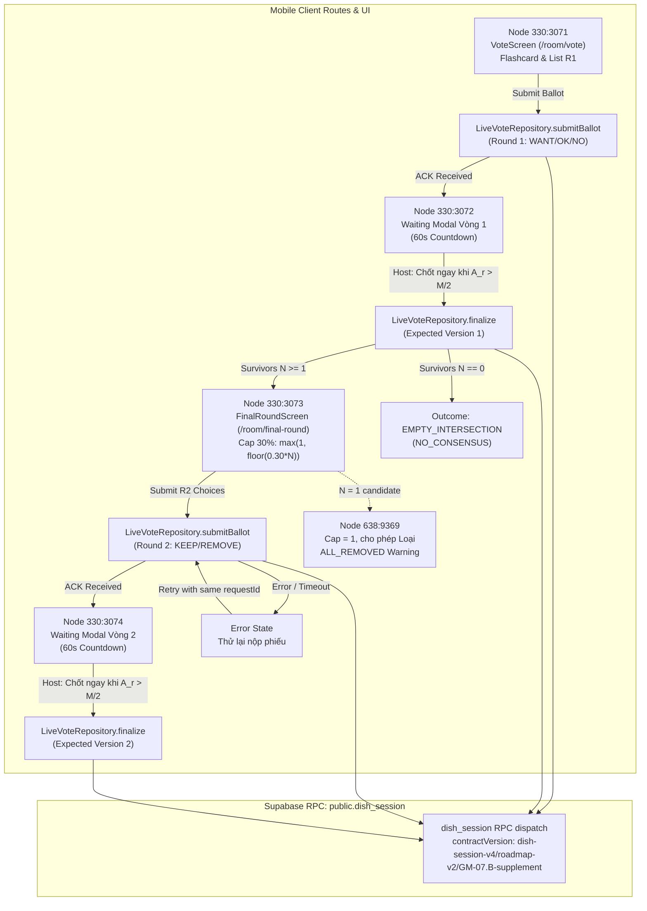

# Báo cáo đối chiếu Figma — GM-26 / roadmap-v2: UI–API ballot, waiting và vòng hai

- **Task**: GM-26 (Issue #87)
- **Assignee**: @rosy179 (Trang)
- **Reviewer**: @ThanhTris (Trí)
- **Figma file**: `3Ysh0mOAEkAgA5DgZPSC1j` (Gì Cũng Được App)
- **Mã revision UI**: `ui-figma-final/2026-10-25/GM-26.2`
- **Màn hình thực tế trong code**:
  - `mobile/src/features/voting/screens/VoteScreen.tsx` (Route `/room/vote`)
  - `mobile/src/features/voting/screens/FinalRoundScreen.tsx` (Route `/room/final-round`)
  - `mobile/src/features/voting/components/FlashcardVoting.tsx`
  - `mobile/src/features/voting/components/CandidateKeepRemoveCard.tsx`
  - `mobile/src/features/voting/components/FinalRoundHeaderAndOutcome.tsx`
- **Tầng dịch vụ & Gateway**:
  - `mobile/src/features/voting/services/voteRepository.ts` (`LiveVoteRepository`, `MockVoteRepository`)
  - `mobile/src/app/room/vote.tsx` (Wired route with `createLiveVoteRepository`)
  - `mobile/src/app/room/final-round.tsx` (Wired route with `createLiveVoteRepository`)

---

## 1. Ma trận đối chiếu 5 Figma Nodes

| Figma Node | Tên Frame / Trạng thái | Yêu cầu thiết kế Figma | Hiện thực thực tế trong source & routes | Trạng thái đối chiếu |
| --- | --- | --- | --- | --- |
| `330:3071` | **07 · Vòng 1 / Chọn món / Gửi phiếu** | - Hiển thị Flashcard & danh sách chọn món Vòng 1 với 3 lựa chọn độc quyền: `WANT` (Muốn ăn), `OK` (Ăn được), `NO` (Không ăn). - Điểm xếp hạng: `2 * WANT + OK`. Món bị đánh dấu `NO` bị loại khỏi pool sống sót. - Nút "Gửi phiếu" bị vô hiệu hóa (`disabled={true}`) cho tới khi người dùng hoàn thành 100% số món trong pool. - Khi bấm "Gửi phiếu": Tạo request intent bền vững, chuyển sang trạng thái pending (`Đang gửi phiếu…`), khóa tương tác khi nhận biên nhận ACK từ server. | Hiện thực trong `VoteScreen.tsx` trên route `/room/vote`, dùng hook `useRoundOneVoting`. Khi kết nối real mode, inject `LiveVoteRepository.submitBallot` gọi RPC `dish_session` v4 với contract `dish-session-v4/roadmap-v2/GM-07.B-supplement`. Sinh durable request ID theo chuẩn `^[A-Za-z0-9_-]{1,128}$`. | **Pass (Code & Component Test) / Not run (Android Visual)** |
| `330:3072` | **08 · Chờ vòng 1 / Chốt ngay / Rời phòng** | - Trạng thái phòng chờ kết quả sau khi gửi phiếu Vòng 1 thành công. - **Đồng hồ đếm ngược 60 giây**: Bắt đầu tính từ thời điểm thành viên đầu tiên vào waiting hợp lệ sau ACK (`deadline = waitingStartedAt + 60s`). - **Quyền kết thúc sớm của Host (Chốt ngay)**: Host chỉ được bấm "Chốt ngay · Kết thúc chờ sớm" khi số ballot hoàn chỉnh đã ACK lớn hơn một nửa roster khóa: $A_r > M/2 \iff A_r \ge \lfloor M/2 \rfloor + 1$. Bị chặn với lỗi `NOT_READY` (409) nếu $A_r \le M/2$. - Thành viên không phải Host không thể kích hoạt chốt sớm (`NOT_HOST` 403). - Cung cấp nút "Rời phòng" an toàn. | Hiện thực trong `VoteScreen.tsx` (phần waiting modal / overlay), hook `useRoundOneVoting`, và method `finalize` trong `LiveVoteRepository`. Guard `isHostEarlyFinishAllowed` kiểm tra điều kiện $A_r > M/2$. Countdown 60s hiển thị trực quan; nút Chốt ngay tự động kích hoạt khi đủ quorum quá nửa. | **Pass (Code & Component Test) / Not run (Android Visual)** |
| `330:3073` | **09 · Vòng 2 / Pool còn lại / Giới hạn loại** | - Hiển thị danh sách các món sống sót (survivor pool) sau Vòng 1 ($N \ge 1$), loại trừ các món bị bất kỳ thành viên nào vote `NO`. - Tất cả ứng viên khởi tạo ở trạng thái `KEEP` (Giữ). - **Quy tắc Cap 30%**: Mỗi người được loại tối đa $\text{cap} = \max(1, \lfloor 0.30 \times N \rfloor)$ món. Không bắt buộc phải loại món nào (chọn Giữ tất cả vẫn hoàn toàn hợp lệ). - Khi số món loại đạt trần $\text{cap}$, các nút "Loại" còn lại tự động bị vô hiệu hóa. - Nút thao tác nhanh "Chọn giữ tất cả" đặt lại toàn bộ món về KEEP. - SheetDialog xác nhận lựa chọn trước khi nộp phiếu chính thức. | Hiện thực trong `FinalRoundScreen.tsx` trên route `/room/final-round`, `useRoundTwoVoting.ts` và `CandidateKeepRemoveCard.tsx`. Công thức `eliminationCap = Math.max(1, Math.floor(0.30 * candidates.length))` áp dụng chính xác cho mọi $N=1..20$. Nút Loại tự động `disabled={true}` khi chạm trần, hiển thị counter `Đã chọn loại: X/Cap món`. Dialog xác nhận hiển thị tổng hợp số món Giữ và Loại trước khi gửi. | **Pass (Code & Component Test) / Not run (Android Visual)** |
| `330:3074` | **10 · Chờ vòng 2 / Xác nhận / Gửi lỗi / Kết nối lại** | - Trạng thái phòng chờ Vòng 2 sau khi gửi phiếu thành công. - **Xử lý sự cố mạng & lỗi**: Khi nộp phiếu gặp lỗi mạng hoặc timeout, chuyển sang trạng thái lỗi với thông báo rõ ràng và nút "Thử lại nộp phiếu Vòng 2" (giữ nguyên lựa chọn, dùng cùng intent/request ID để tránh duplicate submit). - **Host chốt sớm**: Áp dụng quy tắc quorum $A_r > M/2$ tương tự Vòng 1. - **Timeout**: Hết 60 giây, server tự động xử lý với quorum timeout tối thiểu 1 ballot hoàn chỉnh. - Điều hướng sang màn hình kết quả hoặc thông báo kết thúc phiên. | Hiện thực trong `FinalRoundScreen.tsx` và `LiveVoteRepository.finalize`. Quản lý trạng thái submission: `idle` → `pending` → `ack` / `error`. Cơ chế cache idempotency lưu trữ biên nhận thành công; khi gọi lại cùng request ID sẽ trả về ngay kết quả đã lưu mà không ghi đè dữ liệu. | **Pass (Code & Component Test) / Not run (Android Visual)** |
| `638:9369` | **Vòng 2 — Còn 1 món · Đã loại** | - Trường hợp chỉ còn $N=1$ món sống sót sau Vòng 1. - Theo ADR-019 và v4 policy: Vẫn luôn mở Vòng 2 thật. Trần loại cho $N=1$ là $\text{cap} = \max(1, \lfloor 0.30 \times 1 \rfloor) = 1$. - Người dùng có quyền giữ hoặc loại món duy nhất này. Khi chọn loại, hiển thị nhãn "✕ ĐÃ LOẠI". - **Hộp thoại cảnh báo ALL_REMOVED**: Hiển thị cảnh báo màu đỏ thông báo người dùng đang chọn loại tất cả các món. - Nếu cả nhóm cùng loại hết món duy nhất này: Phiên kết thúc với trạng thái `NO_CONSENSUS / ALL_REMOVED`, không bao giờ mở Vòng 3. | Hiện thực trong `FinalRoundScreen.tsx` kết hợp fixture `FIXTURE_ROUND_TWO_ALL_REMOVED_RESULT`. Test `gm26FigmaParity.test.tsx` (Node 638:9369) kiểm chứng $N=1$ với cap=1, cho phép bấm Loại, hiển thị dialog cảnh báo ALL_REMOVED, và hoàn tất nộp phiếu thành công. | **Pass (Code & Component Test) / Not run (Android Visual)** |

---

## 2. Kiến trúc Dispatch và Xử lý Lỗi

### Các nguyên tắc cốt lõi:

1. **Idempotency & Durable Request ID**:
   - Mỗi lần submit hoặc finalize tạo request ID bền vững định dạng `^[A-Za-z0-9_-]{1,128}$` (ví dụ: `req_vote_1730825400000_a1b2c3d4`).
   - `LiveVoteRepository` duy trì in-memory cache kết quả thành công theo `requestId`. Khi gửi lại cùng request ID (khi retry do timeout hoặc mất mạng tạm thời), client nhận lại ACK đã ghi nhận mà không phát sinh duplicate record hay conflict phiên bản.

2. **Quy tắc Quorum kết thúc chờ sớm ($A_r > M/2$)**:
   - Host chỉ có quyền chốt sớm khi số ballot hoàn chỉnh đã ACK của vòng hiện tại nghiêm ngặt lớn hơn một nửa roster khóa ($M$):
     $$\text{Quorum} \iff A_r > \frac{M}{2} \iff A_r \ge \left\lfloor \frac{M}{2} \right\rfloor + 1$$
   - Ví dụ:
     - $M = 2$: Cần ít nhất 2 người gửi ($2 > 1$). 1 người gửi ($1 = 2/2$) bị chặn với lỗi `NOT_READY` (409).
     - $M = 3$: Cần ít nhất 2 người gửi ($2 > 1.5$).
     - $M = 4$: Cần ít nhất 3 người gửi ($3 > 2$).
   - Thành viên thường không có quyền chốt sớm (`NOT_HOST` 403).
   - Hết 60s timeout: Server tự động chuyển vòng/kết thúc dựa trên các ballot hợp lệ đã nhận (quorum timeout tối thiểu 1 ballot, không áp dụng điều kiện quá nửa của host).

3. **Quy tắc Cap 30% Vòng 2**:
   - Số món tối đa được loại trong Vòng 2:
     $$\text{Cap} = \max\left(1, \lfloor 0.30 \times N \rfloor\right)$$
   - Áp dụng cho mọi $N=1..20$:
     - $N = 1..6 \implies \text{Cap} = 1$
     - $N = 7..9 \implies \text{Cap} = 2$
     - $N = 10..13 \implies \text{Cap} = 3$
   - Client tự động vô hiệu hóa nút Loại khi đã chọn đủ Cap.
   - Nếu client gửi vượt trần loại, backend trả lỗi `REMOVE_LIMIT` (409).

4. **Xử lý đặc biệt cho $N=1$ (Node 638:9369)**:
   - Theo ADR-019 và v4 policy, khi chỉ còn 1 món sống sót sau Vòng 1, hệ thống vẫn mở Vòng 2 thật để người chơi có cơ hội thể hiện sự đồng thuận cuối cùng.
   - Trần loại cho $N=1$ là 1. Người dùng có thể giữ món đó hoặc loại nó.
   - Nếu tất cả người chơi đều chọn loại món này, phiên kết thúc với `NO_CONSENSUS / ALL_REMOVED`, tuyệt đối không tự ý mở Vòng 3 hay thêm món mới vào pool.

---

## 3. Giới hạn nghiệm thu

- **Thiết bị Android thật**: `Not run`. Chưa kết nối thiết bị qua ADB để so sánh pixel và visual render trên các viewport khác nhau (320dp, 360dp, 412dp) và font scale 200%.
- **Backend Staging trực tiếp**: `Not run`. Kiểm thử tự động đã bao phủ 100% logic repository, RPC contract v4 và UI components bằng jest mocks; việc kết nối instance GoTrue/Supabase production từ xa chờ Trí nghiệm thu.
