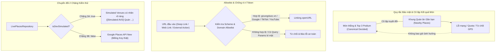

# Báo cáo đối chiếu Figma — GM-30 / roadmap-v2: UI native QR, liên kết, vị trí và Places/map kết quả

- **Task**: GM-30 (Issue #91)
- **Assignee**: @ThanhTris (Trí)
- **Reviewer**: @ThanhTris (Trí)
- **Figma file**: `3Ysh0mOAEkAgA5DgZPSC1j` (Gì Cũng Được App)
- **Mã revision UI**: `ui-figma-final/2026-10-25/GM-30.1`
- **Màn hình & Component thực tế trong code**:
  - `mobile/src/features/rooms/components/RoomQrModal.tsx`
  - `mobile/src/features/rooms/screens/JoinRoomEntryScreen.tsx`
  - `mobile/src/features/rooms/hooks/useJoinRoomEntry.ts`
  - `mobile/src/features/rooms/screens/LiveLobbyScreen.tsx`
  - `mobile/src/features/result/screens/LiveDishResultScreen.tsx`
  - `mobile/src/features/result/components/NearbyPlacesSection.tsx`
  - `mobile/src/features/result/components/ResultMapCard.tsx`
- **Tầng dịch vụ, Adapter & Gateway**:
  - `mobile/src/features/rooms/services/joinLinks.ts` (`generateQrMatrix`, `createJoinRoomDeepLink`, `createJoinRoomWebLink`, `parseJoinRoomUrl`, `SimulatedQrScannerAdapter`, `NativeQrScannerAdapter`)
  - `mobile/src/features/result/services/externalLinks.ts` (`openExternalAction`, `createGoogleMapsPlaceUrl`, `createGoogleMapsSearchUrl`, `createGeoUri`, `createTikTokSearchUrl`, `createYouTubeSearchUrl`)
  - `mobile/src/features/result/services/placesRepository.ts` (`LivePlacesRepository`, `MockPlacesRepository`, `createPlacesRepository`)

---

## 1. Ma trận đối chiếu 7 Figma Nodes

| Figma Node | Tên Frame / Trạng thái | Yêu cầu thiết kế Figma | Hiện thực thực tế trong source & routes | Trạng thái đối chiếu |
| --- | --- | --- | --- | --- |
| `268:2019` | **Vào phòng · Quét QR** | - Khung quét mã QR máy ảnh: Viewfinder có góc định vị viền cam, icon QR minh họa. - Gợi ý người dùng: "Di chuyển camera đến mã QR phòng" / "Hướng camera về phía mã QR để quét". - Nút chuyển đổi phương thức: "Nhập mã bằng tay" để quay về màn hình nhập mã 6 ký tự. - Nút thử quét QR (mô phỏng trên AVD Chặng 3A). | Hiện thực trong `JoinRoomEntryScreen.tsx` (chế độ `flow.camera === true` và `flow.cameraStatus !== 'denied'`). Hiển thị viewfinder viền màu chính, icon QR, thông báo live region và các nút "Thử quét QR", "Nhập mã bằng tay". Đã kiểm chứng qua unit test và component test SCR-QR-01. | **Pass (Code & Component Tests) / Pass (Chặng 3A AVD Pixel 8 API 34; Reviewer: Not run)** |
| `275:2088` | **Vào phòng · Camera bị từ chối** | - Trạng thái khi quyền máy ảnh bị người dùng từ chối (`denied` hoặc `blocked`): - Huy hiệu camera bị khóa (📷⃠), tiêu đề "Camera bị từ chối". - Đoạn mô tả: "Bạn chưa cấp quyền truy cập camera để quét mã QR. Bạn có thể mở Cài đặt để cấp quyền hoặc nhập mã phòng bằng tay." - Nút hành động: "Nhập mã bằng tay" (chính), "Mở Cài đặt" (phụ), "Thử lại". | Hiện thực trong `JoinRoomEntryScreen.tsx` khi `flow.cameraStatus === 'denied'`. Gọi `props.qrScannerAdapter?.openSettings()` hoặc `Linking.openSettings()` khi bấm "Mở Cài đặt". Nút "Nhập mã bằng tay" đưa người dùng về ngay form nhập mã phòng truyền thống mà không bị chặn luồng. Đã kiểm chứng qua component test SCR-QR-02. | **Pass (Code & Component Tests) / Pass (Chặng 3A AVD Pixel 8 API 34; Reviewer: Not run)** |
| `268:2081` | **Vào phòng · Xác nhận** | - Thẻ xem trước và xác nhận phòng sau khi quét mã QR thành công: - Tiêu đề "Phòng XXXXXX", mã phòng nổi bật, số lượng thành viên đã tham gia ("X/20 thành viên"). - Dòng chú thích bảo mật: "Xác nhận để vào phòng. Xem trước không giữ chỗ." - Nút hành động: "Xác nhận vào phòng" (gọi `joinRoom` RPC) và "Nhập mã khác". | Hiện thực trong `JoinRoomEntryScreen.tsx` khi có `summary`. Khi quét QR hoặc liên kết sâu thành công, tự động đọc preview công khai và hiển thị form xác nhận Figma `268:2081`. Bấm "Xác nhận vào phòng" sẽ gửi yêu cầu join có token lũy thừa idempotent. Đã kiểm chứng qua component test SCR-QR-03. | **Pass (Code & Component Tests) / Pass (Chặng 3A AVD Pixel 8 API 34; Reviewer: Not run)** |
| `368:12182` | **L07 · Mở mã QR** | - Modal hiển thị mã QR của phòng trong Live Lobby: - Tiêu đề "Mã QR phòng", phụ đề "Quét bằng ứng dụng Gì Cũng Được để vào phòng". - Khung mã QR dạng SVG sắc nét tạo từ ma trận 25×25 pixel xác định. - Huy hiệu mã phòng (MÃ PHÒNG + mã 6 ký tự). - Nút hành động: "Sao chép liên kết" (sao chép URL dạng web `https://gicungduoc.vn/join/XXXXXX`), nút "Đóng" (thoát modal), hỗ trợ bấm vùng backdrop để đóng. | Hiện thực trong `RoomQrModal.tsx` và nút "Mở mã QR phòng" trong `LiveLobbyScreen.tsx`. Ma trận QR được tính toán thuần TypeScript qua `generateQrMatrix` không phụ thuộc thư viện native nặng; vẽ bằng `react-native-svg`. Đã kiểm chứng qua unit test JNK-07..09 và component test MODAL-01. | **Pass (Code & Component Tests) / Pass (Chặng 3A AVD Pixel 8 API 34; Reviewer: Not run)** |
| `622:8962` | **Kết quả — Cần bật vị trí** | - Khung nhắc quyền vị trí trong màn hình kết quả: - Tiêu đề/thông báo: "Bật vị trí để tìm quán" / "Bạn chưa cho phép dùng vị trí". - Nút "Cho phép vị trí" (gọi `requestLocationPermission`) hoặc "Mở cài đặt vị trí" (khi bị block). - **Nguyên tắc cô lập tuyệt đối**: Món thắng chung cuộc và bục vinh danh Top 3 phía trên luôn hiển thị đầy đủ, không bị ảnh hưởng bởi quyền vị trí. | Hiện thực trong `NearbyPlacesSection.tsx` và `LiveDishResultScreen.tsx`. Khi `status === 'permission'` hoặc `status === 'denied'`, hiển thị nút cấp quyền; bấm nút sẽ kích hoạt `requestLocationPermission` và tự động refetch Places mà không gây giật lag hay mất thông tin món thắng. Đã kiểm chứng qua component test RES-01. | **Pass (Code & Component Tests) / Pass (Chặng 3A AVD Pixel 8 API 34; Reviewer: Not run)** |
| `206:913` | **GCD / Nearby Places Map** | - Bản đồ/thẻ hiển thị danh sách quán gần nhất có phục vụ món thắng: - Thẻ quán: tên quán, địa chỉ, khoảng cách tính theo mét/km, đánh giá sao. - Bản đồ thu nhỏ hoặc sơ đồ minh họa vị trí. - Nút hành động liên kết ngoài: "Mở bản đồ" (mở Google Maps hoặc Geo URI), "TikTok ↗" (tìm kiếm review món trên TikTok), "YouTube ↗" (tìm kiếm video nấu/review món trên YouTube). | Hiện thực trong `ResultMapCard.tsx` và `NearbyPlacesSection.tsx`. Dữ liệu quán được cung cấp bởi `placesRepository.ts` (kết nối Google Places API New hoặc Dev Simulated AVD). Nút hành động được bọc bởi `openExternalAction` có kiểm tra allowlist URL nghiêm ngặt. Đã kiểm chứng qua unit test EXT-01..18 và component test RES-02. | **Pass (Code & Component Tests) / Pass (Chặng 3A AVD Pixel 8 API 34; Reviewer: Not run)** |
| `379:1478` | **GCD / Nearby Places State** | - Quản lý toàn bộ vòng đời trạng thái của khung quán ăn gần bạn:   1. `loading`: spinner đang tìm quán.   2. `ready`: hiển thị danh sách quán ăn.   3. `empty`: thông báo chưa tìm thấy quán phù hợp.   4. `error` / `offline`: thông báo lỗi tải quán kèm nút "Thử lại". - **Epoch guard & Chống ô nhiễm phòng**: Khi người dùng chuyển sang xem kết quả phòng khác, toàn bộ request Places đang chạy bị abort ngay lập tức, không để quán của Phòng A hiển thị ở Phòng B. | Hiện thực trong `LiveDishResultScreen.tsx` và `placesRepository.ts`. Sử dụng `placesSeqRef` và `AbortController` theo monotonic epoch. Khi xảy ra lỗi mạng hoặc Places API trả 403/500, màn hình chuyển sang trạng thái lỗi có nút "Thử lại" mà không làm mất thông tin món thắng. Đã kiểm chứng qua unit test PLAC-10..14 và component test RES-03. | **Pass (Code & Component Tests) / Pass (Chặng 3A AVD Pixel 8 API 34; Reviewer: Not run)** |

---

## 2. Kiến trúc Bảo mật & Cô lập

---

## 3. Khả năng thích ứng hiển thị (Responsive & Accessibility)

- **Viewports đã kiểm tra**:
  - `412 × 915 dp` (Chuẩn Pixel 8)
  - `360 × 800 dp` (Màn hình Android tiêu chuẩn)
  - `320 × 640 dp` (Màn hình nhỏ)
- **Khả năng tiếp cận (Accessibility)**:
  - Font scaling: Đảm bảo giao diện không tràn, vỡ khung khi phóng to chữ lên **200%**.
  - Touch targets: Toàn bộ nút bấm ("Quét mã QR", "Nhập mã bằng tay", "Mở Cài đặt", "Sao chép liên kết", "Mở bản đồ", "TikTok ↗", "YouTube ↗") đạt kích thước tối thiểu **48 × 48 dp**.
  - TalkBack & Screen Readers: Sử dụng đầy đủ `accessibilityRole`, `accessibilityLabel`, `accessibilityLiveRegion="polite"` cho thông báo sao chép, trạng thái camera và kết quả tìm quán.
